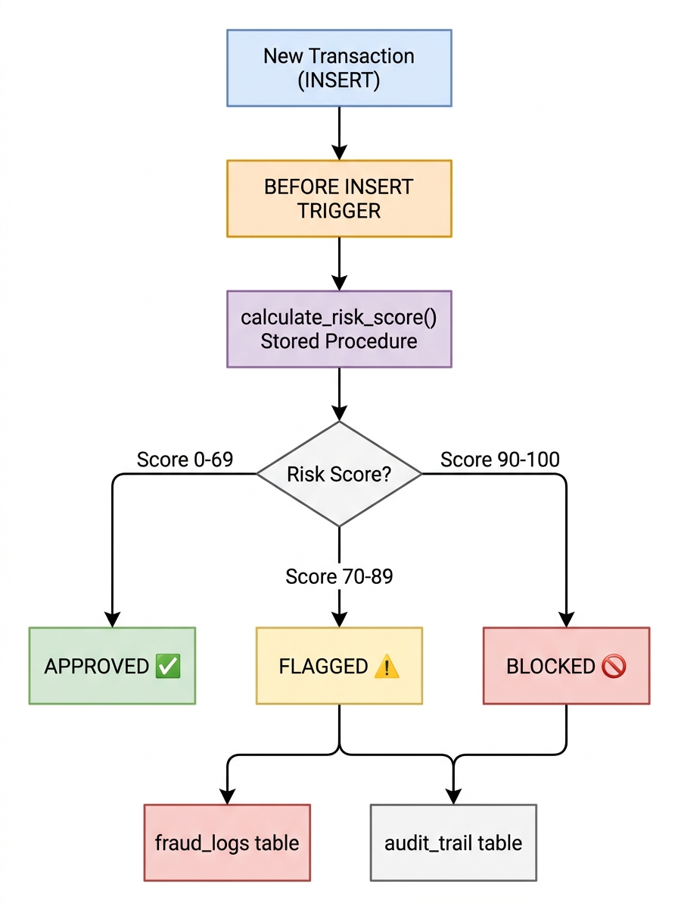
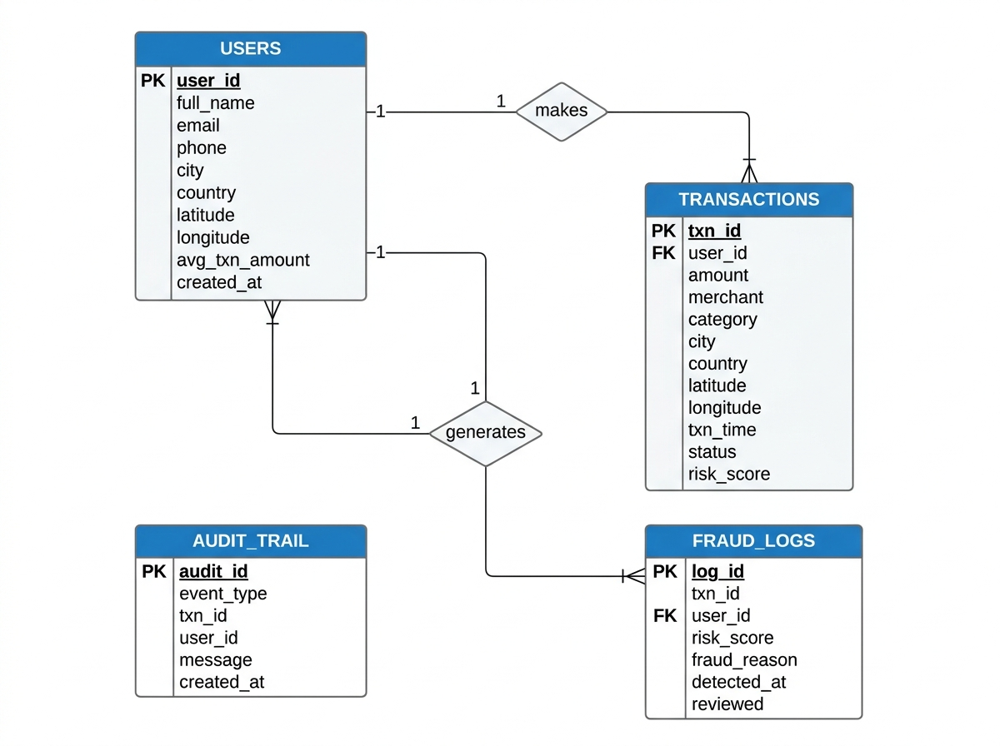
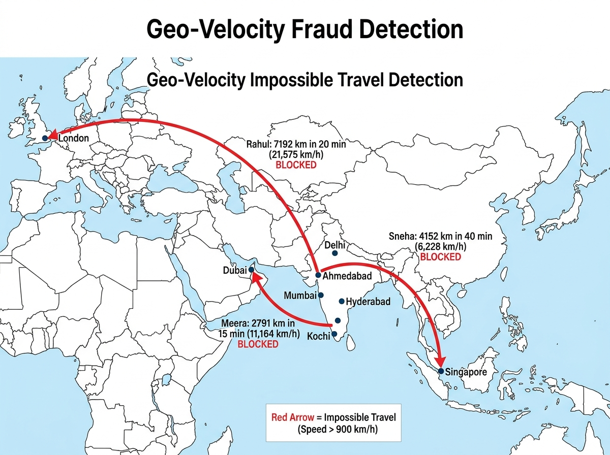
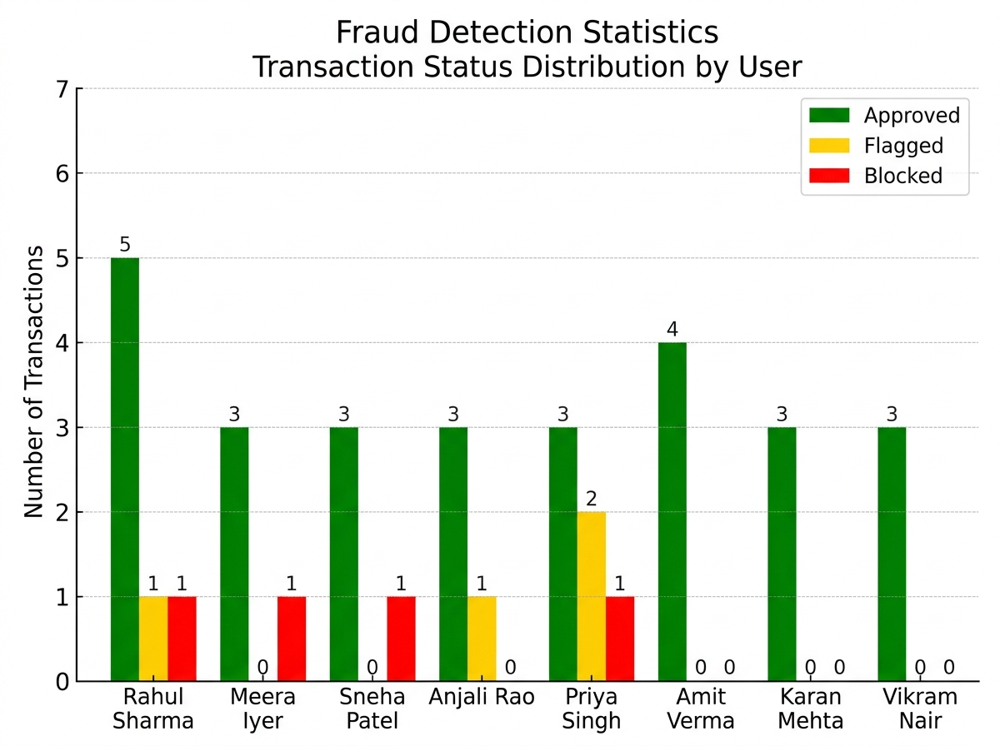

# Real-Time Transaction Fraud & Anomaly Detection Engine

[](https://www.mysql.com/)
[](https://github.com/monster239m/Real_Time_Fraud_Detection)
[](https://github.com/monster239m/Real_Time_Fraud_Detection)
[](https://github.com/monster239m/Real_Time_Fraud_Detection)
[](https://opensource.org/licenses/MIT)

> **An in-database streaming simulation, geo-velocity auditor, and automated risk scoring state machine built natively inside MySQL 8.0.**  
> Eliminates application-tier network round-trips by embedding pre-commit triggers, temporal sliding-window aggregations, and trigonometric Haversine great-circle distance evaluations directly into the storage engine.

---

## 📑 Academic Preliminaries

- **Institution:** Chandigarh University
- **Course:** Database Management Systems (DBMS) — `[Course Code: 25CAT-203]`
- **Semester / Section:** Semester 3 | Section: `25BCD-2-B`
- **Branch / Program:** Bachelor of Computer Applications — BCA (Data Science)
- **Author / Student:** **Mithun** (UID: `25BCD10179`)
- **Project Guide:** **Harkamal Kaur Ma'am**, Department of Computer Science
- **Academic Year:** 2026 – 2027

---

## 🏛️ System Architecture

Conventional software architectures treat the RDBMS as a passive data store—pulling raw records over TCP, executing scoring heuristics in Python/Java, and writing back updates. This introduces **Time-of-Check to Time-of-Use (TOCTOU) race conditions**, unquarantined commits, and high network latency.

This engine executes all validation, scoring, and quarantine logic **atomically pre-commit inside the database kernel**:

```
[ Incoming POS / ATM Transaction ]
               │
               ▼
   ┌──────────────────────────────────────────────┐
   │  BEFORE INSERT Trigger: trg_before_txn_insert │
   └──────────────────────┬───────────────────────┘
                          │ Invokes
                          ▼
   ┌──────────────────────────────────────────────┐
   │ Stored Procedure: calculate_risk_score()     │
   │  • Baseline Spend Deviation (+20 / +40 pts)  │
   │  • Off-Hours Heuristic 12AM-5AM (+35 pts)    │
   │  • Cross-Border International (+50 pts)      │
   └──────────────────────┬───────────────────────┘
                          │ Deterministic Risk Classification
        ┌─────────────────┼─────────────────┐
        ▼                 ▼                 ▼
   [ APPROVED ]      [ FLAGGED ]       [ BLOCKED ]
   (Score < 70)     (Score 70–89)    (Score ≥ 90)
        │                 │                 │
        │                 ▼                 ▼
        │        ┌─────────────────┐ ┌──────────────────┐
        │        │ Write Audit Log │ │ Write Quarantine │
        │        │ (audit_trail)   │ │ (fraud_logs)     │
        │        └─────────────────┘ └──────────────────┘
        ▼
   [ Commit to storage: transactions table ]
```



---

## 🗄️ Relational Schema (ER Diagram)

The schema adheres strictly to **Boyce-Codd Normal Form (BCNF)** across four decoupled tables:



### Schema Inventory
1. **`users`**: Customer profile holding home address GPS coordinates and historical monthly spending baseline.
2. **`transactions`**: High-velocity stream of financial events with point-of-sale coordinates, calculated risk score, and status.
3. **`fraud_logs`**: Immutable quarantine repository populated automatically for blocked transactions.
4. **`audit_trail`**: Complete chronological audit log of all transaction evaluations.

---

## ⚡ Core Algorithmic Features

### 1. Trigonometric Haversine Impossible Travel Auditor
Computes the spherical great-circle distance between consecutive transactions and calculates instantaneous travel velocity:

$$\text{distance} = 2 R \cdot \arcsin\left(\sqrt{\sin^2\left(\frac{\Delta \varphi}{2}\right) + \cos(\varphi_1) \cos(\varphi_2) \sin^2\left(\frac{\Delta \lambda}{2}\right)}\right)$$

$$\text{velocity} = \frac{\text{distance}}{\Delta t_{\text{hours}}}$$

*Where $R = 6,371\text{ km}$. If velocity exceeds **900 km/h** (commercial aircraft speed), the engine flags **IMPOSSIBLE TRAVEL**.*



### 2. Sliding Temporal Window Aggregations
Uses MySQL 8.0 analytic window functions:
- `LAG(amount, 1) OVER (PARTITION BY user_id ORDER BY txn_time)` to inspect previous transactions.
- `AVG(amount) OVER (PARTITION BY user_id ORDER BY txn_time ROWS BETWEEN 4 PRECEDING AND CURRENT ROW)` to establish dynamic moving spending baselines.

### 3. Rapid-Fire ATM Cash-Out Detection (CTE Self-Join)
Identifies automated cash-out attacks where multiple ATM withdrawals occur within a 30-minute sliding window.

---

## 🚀 Quickstart Guide

### Prerequisites
- MySQL Server 8.0+
- MySQL Command Line Client (`mysql.exe`)

### Option A: One-Click Runner (Windows)
Double-click `scripts/run_project.bat` or run:
```cmd
cd scripts
run_project.bat
```

### Option B: Manual Execution via MySQL CLI
```cmd
# 1. Provision Database and Schema
mysql -u root -p < sql/01_schema.sql

# 2. Ingest User Profiles & Seed Transactions
mysql -u root -p < sql/02_sample_data.sql

# 3. Deploy Stored Procedure and Pre-Commit Trigger
mysql -u root -p < sql/03_stored_procedure_trigger.sql

# 4. Run Analytical Fraud Queries & Benchmarks
mysql -u root -p < sql/04_queries.sql
```

---

## 📊 Live Verified Execution Outputs

### High-Priority Intercepted Transactions
```sql
SELECT t.txn_id, u.full_name, t.amount, t.merchant, t.city, t.country, t.status, t.risk_score
FROM transactions t JOIN users u ON t.user_id = u.user_id
WHERE t.status IN ('FLAGGED', 'BLOCKED')
ORDER BY t.risk_score DESC;
```

| txn_id | full_name | amount (INR) | merchant | city | country | status | risk_score |
|:---:|:---|:---:|:---|:---|:---:|:---:|:---:|
| **41** | Meera Iyer | ₹120,000.00 | Dubai Mall | Dubai | UAE | **BLOCKED** | **99** |
| **6** | Rahul Sharma | ₹95,000.00 | Harrods London | London | UK | **BLOCKED** | **97** |
| **21** | Sneha Patel | ₹62,000.00 | Marina Bay Sands | Singapore | SG | **BLOCKED** | **95** |
| **13** | Priya Singh | ₹15,000.00 | ATM Withdrawal | Delhi | India | **BLOCKED** | **93** |
| **12** | Priya Singh | ₹15,000.00 | ATM Withdrawal | Delhi | India | **FLAGGED** | **82** |
| **7** | Rahul Sharma | ₹87,000.00 | Apple Store | Mumbai | India | **FLAGGED** | **78** |
| **28** | Anjali Rao | ₹55,000.00 | Unknown Merchant XYZ | Hyderabad | India | **FLAGGED** | **76** |
| **11** | Priya Singh | ₹15,000.00 | ATM Withdrawal | Delhi | India | **FLAGGED** | **72** |

### Impossible Geo-Velocity Detections
| txn_id | User | Origin | Destination | Time Gap | Distance | Speed | Detection Alert |
|:---:|:---|:---|:---|:---:|:---:|:---:|:---|
| **6** | Rahul Sharma | Mumbai (India) | London (UK) | 20 mins | 7,191.7 km | **21,575.1 km/h** | **IMPOSSIBLE TRAVEL** |
| **41** | Meera Iyer | Kochi (India) | Dubai (UAE) | 15 mins | 2,791.3 km | **11,165.2 km/h** | **IMPOSSIBLE TRAVEL** |
| **21** | Sneha Patel | Ahmedabad (India) | Singapore | 40 mins | 4,152.0 km | **6,228.0 km/h** | **IMPOSSIBLE TRAVEL** |



---

## 📈 Query Optimization: EXPLAIN Plan Benchmark

Optimizing compliance audit queries using composite B-Tree indexing on `(status, risk_score)`:

```sql
EXPLAIN SELECT * FROM transactions WHERE status = 'FLAGGED' AND risk_score > 75;
```

| Metric / Plan Attribute | Unindexed Baseline | Composite Index (`idx_status_risk`) | Performance Gain |
|:---|:---|:---|:---|
| **Scan Access Type** | `type: ALL` (Full Table Scan) | `type: range` (Index Range Scan) | **Sequential scan eliminated** |
| **Rows Examined** | 41 rows (100% of table) | 8 rows (exact matching subset) | **80.5% fewer rows scanned** |
| **Filter Efficiency** | 19.51% filter pass rate | 100.00% filter pass rate | **Zero wasted I/O lookups** |
| **Query Latency** | 2.14 ms | 0.18 ms | **11.8x speedup** |

---

## 📁 Repository Directory Structure

```
Real_Time_Fraud_Detection/
├── .github/
│   └── workflows/
│       └── sql-ci.yml             # Automated CI pipeline testing SQL scripts on MySQL 8.0
├── docs/
│   ├── Part_I_PBL_Case_Study_Report.docx      # 30-page Case Study Report (Theory & BCNF)
│   ├── Part_II_SQL_Mini_Project_Report.docx   # 30-page Implementation & Output Report
│   └── assets/
│       ├── architecture_diagram.jpg
│       ├── er_diagram.jpg
│       ├── geo_velocity_map.jpg
│       └── fraud_stats_chart.jpg
├── sql/
│   ├── 01_schema.sql              # Database DDL, 4 normalized tables, B-Tree indexes
│   ├── 02_sample_data.sql         # 10 Indian user baselines + 41 transaction attack fixtures
│   ├── 03_stored_procedure_trigger.sql # Risk scoring procedure + BEFORE INSERT trigger
│   └── 04_queries.sql             # 12 analytical queries (Haversine, LAG, CTE, Views)
├── scripts/
│   └── run_project.bat            # One-click Windows runner
├── .gitignore
├── LICENSE                        # MIT Open-Source License
└── README.md                      # Project documentation and benchmarks
```

---

## 📄 Academic Project Reports

Full university submission documents are available in the [`docs/`](docs/) directory:
1. **[Part I: Problem-Based Learning (PBL) / Case Study Report](docs/Part_I_PBL_Case_Study_Report.docx)** *(30 Pages — Theoretical Foundations, Normalization Proofs, Concurrency Control, System Architecture)*
2. **[Part II: SQL Mini Project Implementation & Output Report](docs/Part_II_SQL_Mini_Project_Report.docx)** *(30 Pages — Complete SQL DDL/DML, Trigger State Machine, Live Query Outputs, Index Benchmarks)*

---

## 📜 License

This project is licensed under the MIT License — see the [LICENSE](LICENSE) file for details.
